# 📱 WorshipFlow Mobile App — Complete System Specification, Workflows & Site Map

> **Authoritative Blueprint for AI Agent / Mobile Development**  
> **Target Frameworks:** React Native (Expo) / Flutter / Swift / Kotlin  
> **Backend Compatibility:** Firebase Authentication, Cloud Firestore, Serverless Netlify/Express REST API  
> **File Version:** 2.0 (Production Master)

---

## 📑 Table of Contents

1. [Executive Summary & Product Vision](#1-executive-summary--product-vision)
2. [High-Level Architecture & Tech Stack](#2-high-level-architecture--tech-stack)
3. [Complete Site Map & Navigation Hierarchy](#3-complete-site-map--navigation-hierarchy)
   - [Public & Deep-Linked Screens (No Auth Required)](#31-public--deep-linked-screens-no-auth-required)
   - [Authenticated Mobile App Navigation (Bottom Tabs & Stacks)](#32-authenticated-mobile-app-navigation-bottom-tabs--stacks)
   - [Modals, Drawers & Overlays](#33-modals-drawers--overlays)
4. [Detailed Module-by-Module Functional Specifications](#4-detailed-module-by-module-functional-specifications)
   - [Module 1: Song Library, Chords & Player](#module-1-song-library-chords--player)
   - [Module 2: Scheduling & Service Planning](#module-2-scheduling--service-planning)
   - [Module 3: Preaching & Sermon Notes](#module-3-preaching--sermon-notes)
   - [Module 4: Bible Browser & Devotionals](#module-4-bible-browser--devotionals)
   - [Module 5: Live Stage, Confident Monitor & OBS Lower Thirds](#module-5-live-stage-confident-monitor--obs-lower-thirds)
   - [Module 6: Song Playlists & Setlists](#module-6-song-playlists--setlists)
   - [Module 7: Kanban Planner & Tasks](#module-7-kanban-planner--tasks)
   - [Module 8: Events, Conferences & Camp Registration](#module-8-events-conferences--camp-registration)
   - [Module 9: Team Members & Roster Directory](#module-9-team-members--roster-directory)
   - [Module 10: Leave & Availability Calendar](#module-10-leave--availability-calendar)
   - [Module 11: Real-Time Team Chat](#module-11-real-time-team-chat)
   - [Module 12: Freedom Wall (Prayer & Praise Board)](#module-12-freedom-wall-prayer--praise-board)
   - [Module 13: Design & Media Requests](#module-13-design--media-requests)
   - [Module 14: Assembly Bell & Emergency Broadcasts](#module-14-assembly-bell--emergency-broadcasts)
   - [Module 15: Role-Based Access Control (RBAC) & Admin Governance](#module-15-role-based-access-control-rbac--admin-governance)
   - [Module 16: Push & In-App Notifications](#module-16-push--in-app-notifications)
   - [Module 17: Campsite & Offline-First Resilience](#module-17-campsite--offline-first-resilience)
5. [Core User Workflows & Step-by-Step Lifecycles](#5-core-user-workflows--step-by-step-lifecycles)
6. [Data Models & Cloud Firestore Schemas](#6-data-models--cloud-firestore-schemas)
7. [REST API & Real-Time Endpoints Reference](#7-rest-api--real-time-endpoints-reference)
8. [Role-Based Access Control (RBAC) Matrix](#8-role-based-access-control-rbac-matrix)
9. [Mobile-First UI/UX & Native Implementation Blueprint](#9-mobile-first-uiux--native-implementation-blueprint)

---

## 1. Executive Summary & Product Vision

**WorshipFlow** is an all-in-one worship ministry platform engineered to streamline church service planning, song lyrics/chord charts management, real-time stage presentation, team scheduling, member availability, and internal communication.

### Target Personas
1. **Worship Leaders & Music Directors**: Curate weekly joyful/solemn song lineups, transpose keys on the fly, build playlists, rehearse with band members, and publish setlists.
2. **Musicians & Vocalists**: Instant access to transposed chord charts, auto-scrolling lyrics during performance, rehearsal tracks, and schedule acknowledgment.
3. **Pastors & Preachers**: Submit sermon outlines, slides, and scripture references, or claim preaching drafts for upcoming services.
4. **Audio / Tech / Visual Media Operators**: Control real-time projector lyrics, OBS lower thirds broadcasts, track design requests, and ring the church service assembly bell.
5. **Team Members & Volunteers**: Request planned leaves, participate in real-time team chat, post prayer requests on the Freedom Wall, and sign up for church camps.
6. **Pastoral & Administrative Leadership**: Approve member access, assign granular permissions, review ministry stats, and manage financial contributions for retreats.

---

## 2. High-Level Architecture & Tech Stack

### Web Implementation Reference
- **Frontend Framework**: React 18 (Vite), Tailwind CSS, Lucide Icons.
- **Backend / Server**: Express API (`server.ts`) for local development, Netlify Serverless Functions (`netlify/functions/api.ts`) for production.
- **Authentication**: Firebase Auth (Google OAuth provider + Whitelist check).
- **Database**: Cloud Firestore (NoSQL, real-time listeners for chat, schedules, leaves, and live stage).
- **AI Services**: Google Gemini Pro Vision API for OCR (transcribing chords from uploaded phone photos and handwritten sermon notes).
- **Messaging**: Firebase Cloud Messaging (FCM) for Web Push.

### Recommended Mobile App Architecture
- **Framework**: **React Native with Expo (v51+)** using TypeScript, or **Flutter (v3.22+)**.
- **Styling / UI**: **NativeWind (Tailwind v3/v4 for React Native)** or custom design system with dark-mode first palettes.
- **Navigation**: **React Navigation v6/v7** (Native Stack + Bottom Tabs + Slide-over Drawers).
- **State & Real-Time**: TanStack Query (React Query) + Firebase Firestore onSnapshot listeners + Zustand / Redux Toolkit.
- **Local Persistence & Offline**: **MMKV** (ultra-fast key-value storage) + **WatermelonDB** or **SQLite (expo-sqlite)** for offline chord sheet and setlist caching.
- **Device Capabilities**:
  - `expo-camera` / `react-native-image-picker` for Chord OCR.
  - `expo-keep-awake` (prevent phone screen sleep while playing music on stage).
  - `expo-av` / `react-native-track-player` for backing track audio and assembly bell chimes.
  - `expo-notifications` for APNs / FCM push alerts.
  - `react-native-reanimated` + `react-native-gesture-handler` for buttery 60fps auto-scroll, bottom sheets, and Kanban drag-and-drop.

---

## 3. Complete Site Map & Navigation Hierarchy

```mermaid
graph TD
    App[WorshipFlow Mobile App]
    
    %% Public Routes
    App --> Public[Public Deep Links]
    Public --> PubReg["/r/:eventId (Event Registration)"]
    Public --> PubDash["/d/:eventId (Event Live Stats)"]
    Public --> PubCol["/r/:eventId?view=collector (Fee Collector)"]
    Public --> PubPlay["/p/:slug (Shared Playlist Web View)"]
    Public --> PubPreach["/preach-request/:shareId (Guest Sermon Form)"]
    Public --> PubLive["/live-display (OBS Projector Screen)"]

    %% Auth Flow
    App --> Auth[Auth Gate]
    Auth --> Splash[Splash Screen]
    Auth --> Login[Google OAuth Login]
    Auth --> Pending[Access Pending / Review Screen]
    Auth --> Denied[Access Denied Screen]
    Auth --> MainApp[Main Authenticated App]

    %% Bottom Tabs
    MainApp --> TabBar[Bottom Tab Navigator]
    TabBar --> TabHome[1. Home / Dashboard]
    TabBar --> TabSongs[2. Songs & Chords]
    TabBar --> TabSchedule[3. Schedule & Services]
    TabBar --> TabConnect[4. Connect & Chat]
    TabBar --> TabHub[5. More & Admin Hub]

    %% Tab 1: Home
    TabHome --> VerseDay[Verse of the Day Card]
    TabHome --> ServiceTimer[Upcoming Service Widget]
    TabHome --> MyAssignments[My Next Roles]
    TabHome --> BdayBanner[Birthday Celebrations]
    TabHome --> BellChime[Assembly Bell Chime]
    TabHome --> Broadcasts[System Alerts / Marquee]

    %% Tab 2: Songs
    TabSongs --> SongList[Search & Filter Songs]
    TabSongs --> SongDetail[Song Chord & Lyrics View]
    SongDetail --> Transposer[Semitone & Capo Transpose]
    SongDetail --> AutoScroll[Auto-Scroll Engine]
    SongDetail --> StageMode[High-Contrast Stage Mode]
    SongDetail --> PlayerBar[Audio/Video Backing Track]
    TabSongs --> AddSongModal[Add Song Modal / AI OCR]
    TabSongs --> ChordsGrid[Chords Grid View Modal]

    %% Tab 3: Schedule
    TabSchedule --> MonthCal[Calendar Month & List View]
    TabSchedule --> ServiceDetail[Service Roster & Assignments]
    ServiceDetail --> LineupPicker[Joyful & Solemn Song Lineup]
    ServiceDetail --> AckButton[Lineup Acknowledgment]
    ServiceDetail --> ConflictCheck[Leave Conflict Warnings]
    TabSchedule --> TemplatesModal[Team Lineup Templates]
    TabSchedule --> PreachingTab[Preaching Outlines & Claims]

    %% Tab 4: Connect
    TabConnect --> TeamChat[Real-Time Chat Channels]
    TabConnect --> FreedomWall[Prayer & Praise Sticky Board]
    TabConnect --> TeamNotes[Team Shared Notes]
    TabConnect --> PersonalNotes[Personal Devotions & Notes]
    TabConnect --> DesignRequests[Media & Graphics Queue]

    %% Tab 5: Hub
    TabHub --> BibleView[Bible Browser & Scripture Search]
    TabHub --> PlaylistsMgr[Playlist Manager]
    TabHub --> PlannerBoard[Kanban Project Boards]
    TabHub --> EventsManager[Church Camps & Conferences]
    TabHub --> MembersDir[Team Members Directory]
    TabHub --> LeaveCal[Leave & Availability Calendar]
    TabHub --> LiveStageCtrl[Live Projector Controller]
    TabHub --> MediaLib[Background Loops & Media Library]
    TabHub --> AdminPanel[Admin Approval & RBAC Matrix]
    TabHub --> UserSettings[Theme & Notification Settings]
```



### 3.1 Public & Deep-Linked Screens (No Auth Required)
These screens can be accessed via universal deep links or shared URLs:
1. **Event Registration (`/r/:eventId`)**: Clean multi-step registration form for church camps, conferences, and retreats. Handles personal data, emergency contacts, rooming preferences, and payment confirmation.
2. **Event Dashboard (`/d/:eventId`)**: Live public analytics dashboard displaying total registrants, registration progress, group demographics, and attendee lists.
3. **Event Collector Portal (`/r/:eventId?view=collector&token=:token`)**: Lightweight portal for appointed camp treasurers to log and verify cash/bank transfer dues per attendee.
4. **Public Song Playlist (`/p/:slug`)**: Sharable setlist view where anyone can review song titles, keys, artist information, lyrics, chords, and listen to rehearsal tracks.
5. **Guest Preacher Submission (`/preach-request/:shareId`)**: External submission form for visiting guest speakers to submit sermon titles, scripture passages, sermon notes, and presentation slides.
6. **Live Display Screen (`/live-display` & `/live-display-local`)**: Clean presentation canvas rendered on church sanctuary screens, TVs, or OBS Studio (with green/black keying support). Receives live slide updates via Server-Sent Events (SSE) or Firestore real-time snapshots.

### 3.2 Authenticated Mobile App Navigation (Bottom Tabs & Stacks)
The mobile app structure organizes 17+ desktop views into 5 logical native tabs:

| Tab Icon & Label | Primary Screen | Nested / Child Screens & Modals |
| :--- | :--- | :--- |
| **🏠 Home** | Dashboard Screen | Verse of the Day, Assembly Bell modal, Birthday Card modal, My Next Assignments detail, System Broadcast viewer. |
| **🎵 Songs** | Songs Library Screen | Song Detail & Chords View, Add/Edit Song Modal, Camera OCR scanner, Chords Grid View, Song History. |
| **🗓️ Schedule** | Service Calendar Screen | Service Planner & Roster, Joyful/Solemn Song Selector, Team Templates Modal, Preaching Outlines & Claiming. |
| **💬 Connect** | Team Collaboration Hub | Chat Channels & Threads, Freedom Wall Sticky Board, Team Notes, Personal Devotion Notes, Design Requests. |
| **⚡ More / Hub** | Ministry Tools & Admin | Bible Reader, Playlist Manager, Kanban Planner, Events Manager, Member Directory, Leave Calendar, Live Stage Controller, Media Library, Admin Panel, Settings. |

### 3.3 Modals, Drawers & Overlays
- **Song Transpose Bottom Sheet**: Slider from -6 to +6 semitones, Capo picker (1–7), toggle sharp/flat spelling, Nashville Number System switch.
- **Auto-Scroll Floating Pill**: Speed controller (1x to 10x), Play/Pause button, reset to top.
- **Assembly Bell Sanctuary Overlay**: Visual countdown timer (5m / 3m / 1m) with flashing border and audio chime.
- **Broadcast Banner Overlay**: Top marquee banner for urgent church announcements with dismissal sync.
- **Camp Readiness Checklist Modal**: Operational readiness audit checklist before leaving for church retreats.
- **Quick Member Call / Message Drawer**: Tap any scheduled volunteer in a roster to call, SMS, or copy phone number.

---

## 4. Detailed Module-by-Module Functional Specifications

### Module 1: Song Library, Chords & Player
- **Song Catalog**: Infinite scroll or paginated list displaying song title, artist, key, tags, and date updated.
- **Search & Filtering**:
  - Instant client-side fuzzy search across song titles, artists, and lyrics.
  - Multi-select tag chips (e.g., `#Praise`, `#Worship`, `#Solemn`, `#Joyful`, `#Youth`, `#Christmas`).
  - Sort filters: Alphabetical (A-Z), Recently Added, Recently Modified, and "Future Line-Up Only".
- **Future Line-Up Rule**: Songs marked with `isFutureLineup: true` automatically expire after **7 days** (`SEVEN_DAYS_MS = 7 * 24 * 60 * 60 * 1000`). If older than 7 days, the badge is automatically disregarded in the UI.
- **Chord Sheet Viewer**:
  - Formatted text rendering detecting chords above lyrics (monospace font alignment or inline bracket format `[G]Amazing [D]grace`).
  - **Dynamic Key Transposition**: Real-time transposition using mathematical semitone chromatic scales (`C -> C# -> D -> D# -> E -> F -> F# -> G -> G# -> A -> A# -> B`). Supports Capo calculation (e.g. "Key of E, Capo 2 -> Play D").
  - **Auto-Scroll Engine**: Hands-free scrolling for performing musicians. User adjusts speed slider; auto-scroll smoothly scrolls the viewport down and pauses if user touches the screen.
  - **Stage Mode**: Full-screen, pure pitch-black background (`#000000`), extra-large high-contrast text (`#FFFFFF` and `#FACC15` for chords), hidden header and status bar.
  - **Screen Keep-Awake**: Native device screen lock is automatically disabled while viewing chords so the device does not go to sleep during live performance.
- **AI-Powered OCR Import**:
  - Musician snaps a photo of physical chord sheets or sheet music via phone camera or selects from gallery.
  - Uploaded image sent to `/api/ocr` (or `/api/ocr-preaching`), invoking Google Gemini Pro Vision to extract clean Title, Artist, Lyrics, and bracketed Chords.
- **Duplicate Detection**:
  - When saving a new song, backend and client calculate **Jaccard Similarity** on normalized lyric word-bags.
  - If similarity exceeds **85%**, the app warns the user of existing duplicates, showing matching song titles.
- **Integrated Media Player**:
  - Embeds YouTube video or direct audio backing tracks attached to the song (`video_url`).
  - Persistent mini-player bar at the bottom allowing musicians to play along while reading chords.

### Module 2: Scheduling & Service Planning
- **Calendar Views**:
  - **Month View**: Native calendar grid with dots indicating scheduled services, leave conflicts, and special events.
  - **List / Card View**: Chronological cards grouped by upcoming dates with countdown indicators ("Today", "Tomorrow", "In 3 d").
- **Service Roster Structure**:
  - Date (YYYY-MM-DD), Service Type (Sunday Morning, Sunday Evening, Midweek Prayer, Youth Service, Special Camp).
  - Primary Assignments:
    - **Worship Leader** (single member).
    - **Backup Singers** (multi-member array).
    - **Musicians** (array of role + member objects: Acoustic Guitar, Electric Guitar, Bass, Keyboard, Drums, Synthesizer).
    - **Audio & Multimedia Techs** (Sound Engineer, Visuals/OBS Operator, Camera).
- **Role-Based Volunteer Filtering**:
  - When assigning someone to "Drums", the selection picker ONLY shows members who have "Drums" in their member profile `roles`.
- **Joyful & Solemn Song Lineups**:
  - Dedicated slots for "Joyful / Praise" songs (fast tempo) and "Solemn / Worship" songs (slow/reflective tempo).
  - Tapping a song directly opens its chord chart.
- **Lineup Acknowledgment (`lineupAcks`)**:
  - Scheduled volunteers can tap "Acknowledge Lineup" to confirm they have seen the setlist and are rehearsing.
  - Displays checkmark badges with member avatars next to the roster.
- **Leave Conflict Detection**:
  - When picking a member, the system cross-references the `leaves` collection.
  - If a member has approved leave on that date, a warning pill is displayed: `⚠️ On Leave: Family Vacation`.
- **Team Lineup Templates (`team_templates`)**:
  - Save popular team configurations (e.g. "Team Alpha - Full Band", "Acoustic Midweek Team") and load them with one tap.
- **Clipboard Sharing**:
  - One-tap "Copy to Clipboard" formats the entire Sunday roster into a clean emoji-formatted message ready for WhatsApp, Messenger, or Telegram.
- **Historical Lock**:
  - Services in past dates are automatically locked in read-only mode to prevent accidental edits to church records.

### Module 3: Preaching & Sermon Notes
- **Preaching Lifecycle**:
  - `draft`: Created by ministry lead or pastor.
  - `submitted`: Outlines, scripture, and slides submitted.
  - `claimed`: Preacher claims assignment for a specific Sunday.
  - `completed`: Archived after service execution.
- **Preaching Outlines & Slides**:
  - Sermon Title, Scripture Passage, Main Sermon Points, Discussion Questions, and Presentation Slide notes.
- **Guest Preacher Portal**:
  - Generate a secure shareable link (`/preach-request/:shareId`) sent via SMS/WhatsApp to visiting guest pastors.
  - Guest opens form on mobile without logging in, fills out their sermon outline, and uploads their slides.
- **Preaching OCR**:
  - Photograph handwritten sermon outlines or printed church bulletins to auto-populate sermon drafts.

### Module 4: Bible Browser & Devotionals
- **Bible Reader**:
  - Select Book, Chapter, and Verse across multiple translations (KJV, NIV, ESV) via API endpoints `/api/bible/gateway` and `/api/bible/search`.
  - Offline-cached popular scripture chapters.
  - Font scaling, verse copy, and social sharing graphics.
- **Personal Devotions (`users/{userId}/bibleDevotions`)**:
  - Create personal devotional entries linked directly to selected scripture.
  - Fields: Title, Passage Reference, Personal Reflection, Prayer, Key Takeaway.
- **Verse of the Day**:
  - Daily scheduled Scripture with inspirational background graphic.
  - Shareable image card generator for Instagram/Facebook stories.

### Module 5: Live Stage, Confident Monitor & OBS Lower Thirds
- **Live State Management (`live_state` / SSE `/api/live-sse`)**:
  - Controls what is currently displayed on the sanctuary projector screens and live stream lower thirds.
- **Controller Interface (For Tech Team & Worship Leader)**:
  - Slide list showing all song lyrics, scripture verses, or announcement slides.
  - Tapping a line instantly broadcasts it to all connected screens with zero lag.
  - Quick action buttons: **Blank Screen**, **Freeze**, **Clear Chords**, **Show Chorus**, **Emergency Alert**.
- **Display Output Modes (`/live-display`)**:
  - **Full Screen Projector**: Centered lyrics with dynamic video/image background loops.
  - **OBS Lower Thirds**: Transparent background, lower-third gradient bar with animated slide transitions.
  - **Band Confidence Monitor**: Displays Current Lyric Line, Next Upcoming Lyric Line, Key, Tempo, and Current Time clock.
- **Media Library (`media_library`)**:
  - Upload and manage looping background MP4 videos and JPEG/PNG backdrop images (`/api/live-bg-video/:preset`, `/api/live-fade-image`).

### Module 6: Song Playlists & Setlists
- **Setlist Builder**:
  - Group songs into ordered playlists for rehearsals, Sunday services, youth camps, or prayer nights.
  - Reorder tracks via drag-and-drop handles.
  - Set specific key overrides and transition notes per song (e.g., "Pad transition from C to G, no drums on Intro").
- **Public Setlist Sharing (`/p/:slug`)**:
  - Publish playlist with custom URL slug (`/api/public-playlist/publish`).
  - Anyone with the link can listen to rehearsal tracks and view chord charts.

### Module 7: Kanban Planner & Tasks
- **Trello-Style Boards**:
  - Custom boards for church departments (e.g. "Worship Ministry", "Audio Upgrade Project", "Youth Camp 2026").
  - Customizable lists (e.g., "Backlog", "To Do", "In Progress", "Done").
- **Task Cards**:
  - Title, rich text description, file attachments (`/api/planner/upload`).
  - Assigned team members (with avatar badges).
  - Due dates with push notification reminders.
  - Interactive checklists with progress percentage.
  - Real-time card comments with emoji reactions and audit activity logs.
- **"My Tasks" View**:
  - Consolidated view aggregating all cards assigned to the logged-in user across all church boards.

### Module 8: Events, Conferences & Camp Registration
- **Event Creation**:
  - Create church retreats, youth camps, leadership seminars with start/end dates, venue location, registration fees, and banner media.
- **Public Registration (`/r/:eventId`)**:
  - Public mobile registration form for church members and visitors.
  - Gathers attendee full name, age, contact info, emergency contact, t-shirt size, rooming preference, and dietary allergies.
- **Attendee Tracking & Check-In (`/d/:eventId`)**:
  - Admin dashboard displaying registration counts, attendance status, and check-in QR codes.
- **Fee Collection & Installments Tracker**:
  - Appointed collectors log partial installment payments (e.g. "$50 deposit paid, $100 balance remaining").
  - Receipts and proof of bank transfer attachments.
- **Camp Readiness Checklist (`CampReadinessModal`)**:
  - Pre-departure checklist covering PA equipment, cables, microphones, first aid, songbooks, and logistics.

### Module 9: Team Members & Roster Directory
- **Member Profiles**:
  - First Name, Middle Initial, Last Name, Phone, Email, Avatar Photo (Base64 data URL or cloud storage).
  - Status: `active`, `on-leave`, `inactive`.
  - Roles Taxonomy:
    - **Vocals**: Worship Leader, Backup Vocalist, Soprano, Alto, Tenor.
    - **Musicians**: Acoustic Guitar, Electric Guitar, Bass Guitar, Keyboards / Piano, Drums, Percussion.
    - **Technical**: Audio Engineer, Visuals / OBS Operator, Lighting, Stage Hand.
    - **Pastoral**: Pastor, Elder, Youth Facilitator.
- **Contact Shortcuts**:
  - One-tap buttons to dial phone number, send SMS, or launch WhatsApp.
- **Birthdays & Celebrations**:
  - Tracks member birth dates (`YYYY-MM-DD`).
  - Automatic birthday alert banner on dashboard when a member celebrates their birthday.
  - Team members can send digital birthday wishes and cards (`/api/birthday-wish`).

### Module 10: Leave & Availability Calendar
- **Leave Requests (`leaves` collection)**:
  - Members request absence for upcoming weekends (Start Date, End Date, Reason, Coverage Notes).
  - Status lifecycle: `pending` -> `approved` or `rejected`.
- **Roster Guarding**:
  - Worship Leaders planning a service are automatically alerted if a member is on leave, preventing scheduling errors.

### Module 11: Real-Time Team Chat
- **Channels (`chat_channels`)**:
  - Default channels: `#announcements`, `#sunday-service`, `#band-rehearsals`, `#tech-team`.
- **Chat Features**:
  - Real-time messaging via Firestore subcollections (`chat_channels/{channelId}/messages`).
  - Read receipts (`seen_receipts`).
  - Message reactions (👍, ❤️, 🔥, 🙏, 🎵).
  - Pin important messages to channel header.
  - Edit and delete own messages.
  - File and image attachment previews.

### Module 12: Freedom Wall (Prayer & Praise Board)
- **Digital Interactive Corkboard**:
  - Team members post virtual sticky notes for prayer requests, answered prayers, and encouraging Bible verses.
  - Sticky note color themes (Yellow, Rose, Sky, Mint, Lavender).
  - Anonymous or signed postings.
  - Interactive "Amen" / Like counts and threaded replies.

### Module 13: Design & Media Requests
- **Media Production Queue**:
  - Submit requests for Sunday sermon slides, event promotional posters, social media square graphics, or LED video wall graphics.
  - Specify target dimensions, delivery deadlines, reference files, and assign to media designers.
  - Status tracking: `Pending` -> `In Progress` -> `Review` -> `Done`.

### Module 14: Assembly Bell & Emergency Broadcasts
- **Assembly Bell Countdown Chime**:
  - Church sound operator or leader triggers sanctuary chime with countdown (5 minutes, 3 minutes, 1 minute).
  - Plays custom bell chime audio file through device speaker / sanctuary soundboard.
- **Administrative Broadcast System**:
  - Super-admins can push high-priority announcement overlays or marquee text banners to all connected user screens simultaneously (`/api/broadcasts`).

### Module 15: Role-Based Access Control (RBAC) & Admin Governance
- **Access Whitelist**:
  - New users signing in via Google Auth start in `pending` status.
  - Super-admin receives notification and approves or denies entry via `/api/auth/approve`.
- **Granular Roles**:
  - `admin`, `leader` (Worship Leader), `planning_lead`, `musician`, `audio_tech`, `member`, `qa_specialist`, `guest`.
- **Admin Dashboard**:
  - Real-time audit logs of active user sessions (`useSessionTracking.ts`).
  - Inline role promotion / demotion.
  - Revoke user access with one click.

### Module 16: Push & In-App Notifications
- **FCM Web / Mobile Push**:
  - Token registration at `/api/fcm-token`.
  - Notifications triggered on:
    - New schedule published / member assigned to Sunday service.
    - Joyful/Solemn song lineup finalized.
    - Leave request approved or rejected.
    - Assigned a task card in Kanban planner.
    - Urgent administrative broadcast.
- **In-App Notification Inbox**:
  - Badge counter on home screen bell icon.
  - Mark single or all notifications as read / unread.

### Module 17: Campsite & Offline-First Resilience
- **Campsite Mode**:
  - Designed for church retreats held in remote mountains or beaches without internet connectivity.
  - Offline session cache (`wf_auth_session_v2`, `wf_auth_role_v2`) maintains login state for 30 days without reaching Firebase servers.
  - Pre-cached song library and setlists remain accessible and transposable 100% offline.
  - Local network endpoint (`/api/camp-status`) to switch between local Wi-Fi server and cloud Firestore.

---

## 5. Core User Workflows & Step-by-Step Lifecycles

### Workflow A: User Authentication & Whitelist Onboarding
```
[User installs app] 
       │
       ▼
[Google OAuth Sign-In] 
       │
       ▼
[Check Email against Approved Users]
       │
   ├──▶ Email in approved list ──────────────▶ Status: Approved ──▶ Enter Main App
   ├──▶ Email is Admin (jayfullsnackdev@...) ─▶ Status: Admin ─────▶ Enter Admin App
   └──▶ Email NOT recognized ────────────────▶ Status: Pending
                                                      │
                                                      ▼
                                       [Auto-post to /api/auth/request]
                                                      │
                                                      ▼
                                       [Admin reviews request in Admin Panel]
                                                      │
                                         ├── Approve ──▶ Push alert sent ──▶ User enters app
                                         └── Deny ────▶ User sees "Access Denied" screen
```

### Workflow B: Sunday Service Planning & Lineup Acknowledgment
```
[Worship Leader opens Schedule Tab]
       │
       ▼
[Tap "Add Service" / Select Date]
       │
       ▼
[Assign Roles with Auto-Filter]
  ├── Worship Leader (Filtered by Leader role)
  ├── Backup Singers (Filtered by Vocalist role)
  └── Band Musicians (Filtered by Instrument: Keys, Drums, etc.)
  * System alerts if any member is on Leave on that date
       │
       ▼
[Select Song Lineup]
  ├── Joyful Song (Fast praise)
  └── Solemn Song (Worship / reflective)
       │
       ▼
[Publish Schedule & Notify Team]
  ├── Email & Push Notification sent via /api/schedules/:id/notify
  └── Members receive alert: "You've been scheduled for Sunday!"
       │
       ▼
[Band Members Open App]
  ├── View assigned songs
  ├── Transpose chords to rehearsal key
  └── Tap "Acknowledge Lineup" (lineupAcks records confirmation)
```

### Workflow C: Live Stage Presentation Workflow
```
[Church Service Starts]
       │
       ▼
[Tech Operator opens Live Stage Controller on Mobile / Tablet]
       │
       ▼
[Sanctuary Projector / OBS opens /live-display URL]
       │
       ▼
[Operator taps Song or Scripture Verse]
       │
       ├── Updates Firestore /live_state & triggers SSE stream
       ├── Sanctuary Screen displays lyrics with motion video background
       ├── OBS Livestream displays transparent Lower Thirds banner
       └── Musician Stage Monitor displays Current Line + Next Line + Key
```

### Workflow D: Camp Registration & Financial Collection
```
[Admin creates "Youth Camp 2026" Event]
       │
       ▼
[Generate Public Link /r/:eventId]
       │
       ▼
[Church Member opens link on phone]
  ├── Step 1: Attendee Information (Name, Age, T-Shirt)
  ├── Step 2: Emergency Contact & Medical Info
  └── Step 3: Rooming Preference & Submit
       │
       ▼
[Registration Saved in Firestore]
       │
       ▼
[Camp Treasurer opens Collector Portal]
  ├── Looks up registrant
  ├── Enters Cash or Bank installment payment
  └── Balance automatically recalculates in real-time
```

---

## 6. Data Models & Cloud Firestore Schemas

### 6.1 TypeScript Core Interfaces

```typescript
// ── Song & Tags ─────────────────────────────────────────────────────────────
export interface Tag {
  id: string;
  name: string;
  color: string;
}

export interface Song {
  id: string;
  title: string;
  artist: string;
  lyrics: string;
  chords: string;
  tags: Tag[];
  video_url?: string;
  isFutureLineup?: boolean;
  created_at: string;
  updated_at: string;
  created_by_name?: string;
  created_by_photo?: string;
  updated_by_name?: string;
  updated_by_photo?: string;
}

// ── Team Members ────────────────────────────────────────────────────────────
export interface Member {
  id: string;
  name: string;
  firstName?: string;
  middleInitial?: string;
  lastName?: string;
  phone: string;
  email: string;
  photo: string; // Base64 data URL or Cloud Storage URL
  roles: string[]; // e.g. ["Worship Leader", "Acoustic Guitar", "Drums"]
  status: "active" | "on-leave" | "inactive";
  notes: string;
  birthdate?: string; // "YYYY-MM-DD"
  userId?: string; // Matching Firebase Auth UID
  created_at?: string;
  updated_at?: string;
}

// ── Schedules & Rosters ─────────────────────────────────────────────────────
export interface ScheduleMember {
  memberId: string;
  name: string;
  photo: string;
  role: string;
}

export interface Schedule {
  id: string;
  date: string; // YYYY-MM-DD
  serviceType?: string; // "Sunday Morning", "Midweek", "Youth", "Camp"
  eventName?: string;
  worshipLeader?: ScheduleMember | null;
  backupSingers?: ScheduleMember[];
  musicians?: ScheduleMember[];
  songLineup?: {
    joyful?: string;
    solemn?: string;
  };
  assignments?: {
    role: string;
    members: ScheduleMember[];
  }[];
  notes?: string;
  created_by_name?: string;
  created_by_photo?: string;
  created_by_uid?: string;
  lineupAcks?: {
    userId: string;
    userName: string;
    photo?: string;
  }[];
}

// ── Ministry Schedules (Leaders & Preachers) ────────────────────────────────
export type MinistryScheduleCategory = "worship_leader" | "preacher" | "youth_facilitator";
export type PreacherServiceType = "sunday" | "midweek";

export interface WorshipLeaderScheduleItem {
  id: string;
  date: string; // YYYY-MM-DD
  month: string; // "August 2026"
  category?: MinistryScheduleCategory;
  preacherServiceType?: PreacherServiceType;
  worshipLeader: string; // Name of Leader, Preacher, or Facilitator
  worshipLeaderId?: string;
  worshipLeaderPhoto?: string;
  backupSingers: string[];
  backupSingerIds?: string[];
  isGuestSpeaker?: boolean;
  sermonTitle?: string;
  topicSharing?: string;
  completed?: boolean;
  notes?: string;
  created_at?: string;
  updated_at?: string;
}

// ── Leave Requests ──────────────────────────────────────────────────────────
export interface LeaveRequest {
  id: string;
  memberId: string;
  memberName: string;
  startDate: string; // YYYY-MM-DD
  endDate: string; // YYYY-MM-DD
  reason: string;
  status: "pending" | "approved" | "rejected";
  createdAt: string;
}

// ── Kanban Planner ──────────────────────────────────────────────────────────
export interface PlannerBoard {
  id: string;
  title: string;
  description?: string;
  isArchived?: boolean;
  created_at: string;
}

export interface PlannerList {
  id: string;
  boardId: string;
  title: string;
  order: number;
}

export interface PlannerCard {
  id: string;
  boardId: string;
  listId: string;
  title: string;
  description?: string;
  order: number;
  assignedMembers?: string[];
  dueDate?: string;
  checklist?: { id: string; text: string; done: boolean }[];
  attachments?: { name: string; url: string; size: number }[];
  isArchived?: boolean;
}

// ── Events & Registrations ──────────────────────────────────────────────────
export interface ChurchEvent {
  id: string;
  title: string;
  description: string;
  bannerUrl?: string;
  startDate: string;
  endDate: string;
  location: string;
  fee: number;
  createdAt: string;
}

export interface EventRegistrant {
  id: string;
  fullName: string;
  email: string;
  phone: string;
  age: number;
  emergencyContact: { name: string; phone: string; relation: string };
  roomingPreference?: string;
  dietaryRestrictions?: string;
  registeredAt: string;
}

export interface EventContribution {
  memberId: string;
  memberName: string;
  totalPaid: number;
  remainingBalance: number;
  payments: {
    date: string;
    amount: number;
    method: "cash" | "gcash" | "bank_transfer";
    receivedBy: string;
  }[];
}

// ── Live Stage State ────────────────────────────────────────────────────────
export interface LiveStageState {
  currentSlide: {
    title?: string;
    lyrics?: string;
    scripture?: string;
    translation?: string;
  };
  mode: "lyrics" | "scripture" | "blank" | "announcement";
  backgroundVideoPreset?: string;
  updatedAt: number;
}
```

### 6.2 Firestore Collections & Security Rules Overview

| Collection Path | Read Rule | Write Rule | Description |
| :--- | :--- | :--- | :--- |
| `/wfSongs/{songId}` | Authenticated | Role: Admin, Leader, Musician | Worship song library |
| `/events/{eventId}` | Public (`true`) | Authenticated (`request.auth != null`) | Church events & camps |
| `/events/{id}/registrants/{rId}` | Public (`true`) | Public Create / Auth Update | Event attendee registrations |
| `/events/{id}/contributions/{cId}`| Public Read | Public Create/Update / Auth Delete | Camp fee payment tracking |
| `/chat_channels/{chId}/messages/{m}`| Authenticated | Server/Authenticated only | Real-time church chat |
| `/users/{uid}/bibleDevotions/{dId}` | User Only (`auth.uid == uid`) | User Only (`auth.uid == uid`) | Private personal devotions |
| `/wfPlaylists/{playlistId}` | Authenticated | Authenticated | Song setlists |
| `/sharedPlaylists/{slug}` | Public (`true`) | Server only (`false`) | Public shared playlists |
| `/live_state/{doc}` | Public (`true`) | Server only (`false`) | Real-time projector/OBS state |
| `/leaves/{leaveId}` | Authenticated | Authenticated | Member absence requests |
| `/team_templates/{templateId}` | Authenticated | Authenticated | Reusable roster presets |
| `/media_library/{mediaId}` | Public (`true`) | Authenticated | Stage background loops/images |
| `/approved_users/{docId}` | Authenticated | Admin only | RBAC whitelist directory |

---

## 7. REST API & Real-Time Endpoints Reference

All endpoints are hosted on `/api/...` in Express / Netlify Functions.

### 7.1 Authentication & User Governance
- `GET /api/auth/check?email=:email` -> Checks if user email is approved and returns their role.
- `POST /api/auth/request` -> Submits a pending access request for admin review.
- `GET /api/auth/pending` -> Lists all pending registration requests (Admin only).
- `POST /api/auth/approve` -> Body: `{ email, role }` -> Approves user and grants access.
- `DELETE /api/auth/revoke` -> Body: `{ email }` -> Revokes user access.
- `PUT /api/auth/update-role` -> Body: `{ email, role }` -> Changes user's RBAC role.
- `GET /api/auth/users` -> Lists all approved system users.

### 7.2 Songs & Library
- `GET /api/songs` -> Returns all songs with tags, supports search and tag query parameters.
- `GET /api/songs/:id` -> Returns full details of a specific song.
- `POST /api/songs` -> Creates a new song. Validates against duplicates using Jaccard word-bag similarity.
- `PUT /api/songs/:id` -> Updates an existing song.
- `PATCH /api/songs/:id` -> Partially updates song fields (e.g. toggling `isFutureLineup`).
- `DELETE /api/songs/:id` -> Deletes a song (Admin / Leader only).
- `GET /api/tags` -> Lists all song category tags.
- `POST /api/tags` -> Creates a new tag `{ name, color }`.
- `DELETE /api/tags/:id` -> Deletes a tag.
- `POST /api/ocr` -> Multipart upload of sheet music photo. Returns extracted title, artist, chords, and lyrics.

### 7.3 Schedules & Rosters
- `GET /api/schedules` -> Lists all scheduled church services.
- `POST /api/schedules` -> Creates a service schedule.
- `PUT /api/schedules/:id` -> Updates an existing schedule.
- `DELETE /api/schedules/:id` -> Deletes a schedule.
- `POST /api/schedules/:id/notify` -> Dispatches push & email notifications to all assigned volunteers.

### 7.4 Preaching & Sermons
- `GET /api/preaching-drafts` -> Fetches all sermon drafts.
- `POST /api/preaching-drafts` -> Creates a new sermon draft.
- `PUT /api/preaching-drafts/:id` -> Updates sermon draft.
- `PATCH /api/preaching-drafts/:id/claim` -> Preacher claims an upcoming preaching slot.
- `PATCH /api/preaching-drafts/:id/complete` -> Marks sermon completed and archived.
- `POST /api/preaching-shares` -> Generates guest speaker share link (`/preach-request/:shareId`).
- `GET /api/preaching-shares/public/:id` -> Guest speaker fetches preaching request details.
- `POST /api/preaching-shares/public/:id/submit` -> Guest speaker submits sermon notes & slides.
- `POST /api/ocr-preaching` -> Transcribes handwritten sermon notes.

### 7.5 Live Stage & Broadcast
- `GET /api/live-state` -> Returns current active slide / live state.
- `GET /api/live-sse` -> Server-Sent Events real-time stream for projector displays.
- `POST /api/live-push` -> Controller broadcasts new slide or lyric line.
- `POST /api/live-bg-video/:preset` -> Uploads background video loop (up to 500MB).
- `GET /api/live-bg-video/:preset` -> Streams video loop.
- `POST /api/live-fade-image` -> Uploads background fade image (up to 200MB).
- `POST /api/reset-live-bg` -> Resets stage background to default.

### 7.6 Planner (Kanban)
- `GET /api/planner/boards` -> Returns active boards.
- `POST /api/planner/boards` -> Creates board.
- `GET /api/planner/boards/:id/lists` -> Returns lists in a board.
- `POST /api/planner/boards/:id/lists` -> Adds list to board.
- `GET /api/planner/boards/:id/cards` -> Returns cards in a board.
- `POST /api/planner/cards` -> Adds card to list.
- `PATCH /api/planner/cards/:id/move` -> Reorders or moves card across lists `{ listId, order }`.
- `POST /api/planner/cards/:id/comments` -> Adds comment to card.
- `POST /api/planner/upload` -> Uploads attachment to card.
- `GET /api/planner/my-cards` -> Returns cards assigned to currently logged-in user.

### 7.7 Team Chat
- `GET /api/chat/messages?channel=:channelId` -> Fetches channel message history.
- `POST /api/chat/message` -> Sends new message `{ channelId, text, attachments }`.
- `POST /api/chat/reaction` -> Adds emoji reaction to message.
- `POST /api/chat/pin` -> Pins message to channel.
- `PATCH /api/chat/message/:id` -> Edits message.
- `DELETE /api/chat/message/:id` -> Deletes message.

### 7.8 Leaves, Notes & Broadcasts
- `GET /api/leaves` -> Fetches all leave requests.
- `POST /api/leaves` -> Submits new leave request.
- `PATCH /api/leaves/:id` -> Approves or rejects leave request.
- `DELETE /api/leaves/:id` -> Cancels leave request.
- `GET /api/broadcasts` -> Returns active administrative broadcasts.
- `POST /api/broadcasts` -> Publishes high-priority broadcast banner.
- `POST /api/broadcasts/:id/dismiss` -> Dismisses broadcast for current user.
- `GET /api/notifications` -> Fetches user in-app notification inbox.
- `POST /api/fcm-token` -> Registers mobile device push notification token.

---

## 8. Role-Based Access Control (RBAC) Matrix

| Permission Capability | Admin | Worship Leader | Planning Lead | Musician | Audio / Tech | Member | Guest / Visitor |
| :--- | :---: | :---: | :---: | :---: | :---: | :---: | :---: |
| **View Songs & Chords** | ✅ | ✅ | ✅ | ✅ | ✅ | ✅ | ❌ (Setlist only) |
| **Transpose & Auto-Scroll** | ✅ | ✅ | ✅ | ✅ | ✅ | ✅ | ❌ |
| **Add New Song** | ✅ | ✅ | ❌ | ❌ | ❌ | ❌ | ❌ |
| **Edit / Delete Song** | ✅ | ✅ | ❌ | ❌ | ❌ | ❌ | ❌ |
| **Create / Edit Schedules** | ✅ | ✅ | ✅ | ❌ | ❌ | ❌ | ❌ |
| **Acknowledge Lineup** | ✅ | ✅ | ✅ | ✅ | ✅ | ✅ | ❌ |
| **Control Live Stage (OBS)** | ✅ | ✅ | ❌ | ❌ | ✅ | ❌ | ❌ |
| **Upload Live Backgrounds** | ✅ | ❌ | ❌ | ❌ | ✅ | ❌ | ❌ |
| **Submit Leave Request** | ✅ | ✅ | ✅ | ✅ | ✅ | ✅ | ❌ |
| **Approve Leave Requests** | ✅ | ✅ | ❌ | ❌ | ❌ | ❌ | ❌ |
| **Manage Kanban Boards** | ✅ | ✅ | ✅ | ❌ | ❌ | ❌ | ❌ |
| **Create Church Events** | ✅ | ❌ | ✅ | ❌ | ❌ | ❌ | ❌ |
| **Collect Camp Dues** | ✅ | ❌ | ✅ | ❌ | ❌ | ❌ | ❌ (Authorized only) |
| **Post on Freedom Wall** | ✅ | ✅ | ✅ | ✅ | ✅ | ✅ | ❌ |
| **Chat in Team Channels** | ✅ | ✅ | ✅ | ✅ | ✅ | ❌ (View only) | ❌ |
| **Approve Users (Whitelist)**| ✅ | ❌ | ❌ | ❌ | ❌ | ❌ | ❌ |
| **Promote Roles** | ✅ | ❌ | ❌ | ❌ | ❌ | ❌ | ❌ |

---

## 9. Mobile-First UI/UX & Native Implementation Blueprint

When building the mobile app version, instruct the AI to follow these specific native mobile patterns:

### 1. Stage Performance Viewport
- **Orientation**: Must support both **Portrait** and **Landscape** modes. Landscape mode is the preferred standard for tablet and phone stands attached to microphone stands.
- **Wakelock**: Automatically trigger `expo-keep-awake` or `react-native-keep-awake` when entering any song chord chart or stage display view.
- **Auto-Scroll Performance**: Implement using `react-native-reanimated` with `useAnimatedScrollHandler` to ensure the scroll thread runs at 60fps on native UI thread without stuttering.

### 2. Touch Gestures & Micro-Interactions
- **Swipe Between Songs**: Horizontal swipe gesture inside a Setlist/Playlist to navigate to the Next Song or Previous Song without returning to the list.
- **Pinch to Zoom Font**: Two-finger pinch gesture in chord charts to dynamically scale font size from 12px to 32px for optimal readability on different stage distances.
- **Quick Action Bottom Sheets**: Replace desktop modal popups with smooth native bottom sheets (`@gorhom/bottom-sheet` in React Native).

### 3. Media & Backing Audio Engine
- Implement a background audio service (`react-native-track-player`) so rehearsal MP3s or YouTube audio continue playing even when the musician locks the phone or switches apps.
- Provide lock-screen audio playback controls (Play, Pause, Skip, Scrub).

### 4. Push Notification Handling
- On app launch, request notification permissions via `expo-notifications`.
- Save device token to `/api/fcm-token`.
- Support interactive notification actions:
  - *"New Schedule Published"* -> Tapping notification opens the specific Sunday service roster.
  - *"Acknowledge Lineup"* -> Direct action button on the push notification banner.

### 5. Campsite / Offline Mode Implementation
- Cache all songs, tags, and setlists in a local SQLite or MMKV database.
- When `NetInfo.isConnected` is `false`, the app must seamlessly switch to the local SQLite database without displaying intrusive error banners.
- When connection restores, background worker syncs any offline notes or lineup acknowledgments.

---

## 📄 How to Use This Specification

Feed this entire document into your mobile development AI (e.g. Claude 3.5 Sonnet, GPT-4o, Cursor, or Antigravity) with the following system prompt:

> *"You are an expert mobile developer specializing in React Native (Expo) and Flutter. Read the provided WorshipFlow complete specification. Build the mobile application implementing the 5-tab navigation, all 17 feature modules, exact data schemas, and native mobile UX patterns outlined in the document."*
